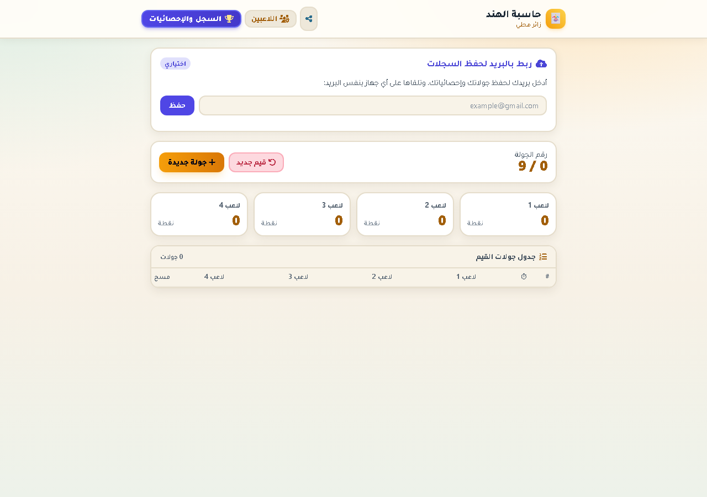

<div align="center">
  
  <h1>حاسبة نقاط لعبة الهند</h1>
  <p>حاسبة نقاط عربية للعبة الهند — نسخة ويب + نسخة أوفلاين بملف واحد</p>
</div>

[](https://hindcalc.vercel.app/)
[](offline/dist/index.html)
[](LICENSE)



## المزايا

- تسجيل اللاعبين والجولات وحساب النقاط تلقائياً.
- سجل ليالي اللعب وإحصائيات تراكمية لكل لاعب.
- تقرير نصي جاهز للمشاركة بعد نهاية اللعبة.
- حفظ في قاعدة بيانات مع رقم سري (PIN) من 4 أرقام.
- نسخة أوفلاين مستقلة تعمل بدون إنترنت وبدون خادم.
- واجهة عربية (RTL) وأصوات للجولات.

## البنية

```
index.html      واجهة الموقع
api/            دوال Vercel (auth / load / save / report)
offline/        بناء النسخة الأوفلاين في ملف HTML واحد
audio/          أصوات الجولات
```

## التشغيل

### 1) النسخة الأوفلاين

الملف الجاهز موجود في `offline/dist/index.html` — افتحه مباشرة في المتصفح.

لإعادة بنائه بعد التعديل على `offline/src/index-original.html`:

```bash
cd offline
node build.js
```

أو شغّله على منفذ محلي:

```bash
cd offline
node server.js
```

النسخة الأوفلاين لا تحتاج حساباً ولا مزامنة؛ الحفظ فيها داخل المتصفح.

### 2) الموقع الكامل (Vercel + Turso)

1. أنشئ قاعدة بيانات Turso ونفّذ:

```sql
CREATE TABLE hind_users (
  email TEXT PRIMARY KEY,
  data TEXT,
  pin_hash TEXT,
  updated_at TEXT
);
```

2. أضف متغيرات البيئة في Vercel:

| المتغير | الوصف |
|---------|-------|
| `TURSO_DATABASE_URL` | رابط قاعدة البيانات |
| `TURSO_AUTH_TOKEN` | توكن قاعدة البيانات |
| `ALLOWED_ORIGIN` | اختياري: أصل مسموح للاتصال من نطاق آخر |

3. ارفع المشروع على Vercel — مجلد `api/` يُنشر كدوال serverless، و`index.html` كواجهة ثابتة.

## الأمان

- لا توجد مفاتيح أو كلمات مرور داخل الكود؛ كل الأسرار عبر متغيرات البيئة.
- رقم PIN يُخزَّن مشفّراً بـ `scrypt` مع salt عشوائي.
- حد لمحاولات الرقم السري الفاشلة: 20 محاولة لكل IP و10 لكل حساب كل 10 دقائق.
- CORS مغلق افتراضياً، ولا يُفتح إلا لأصل تحدده في `ALLOWED_ORIGIN`.
- رسائل الأخطاء لا تُرجع تفاصيل داخلية.

ملاحظات:

- PIN من 4 أرقام ضعيف بطبيعته؛ حد المحاولات يقلل خطر التخمين لكن لا تجعله سراً وحيداً لبيانات حساسة.
- الحسابات القديمة التي أُنشئت قبل إضافة PIN: أول تسجيل دخول بعد التحديث يثبّت الرقم، فسجّل دخولك مرة مباشرة بعد النشر.
- مسار `/api/report` يستخدم `GET` ويستقبل الرقم السري في الرابط (يظهر في سجلات الخادم)؛ يُفضّل تحويله إلى `POST` قبل استخدامه على نطاق واسع.

## الترخيص

[MIT](LICENSE)
